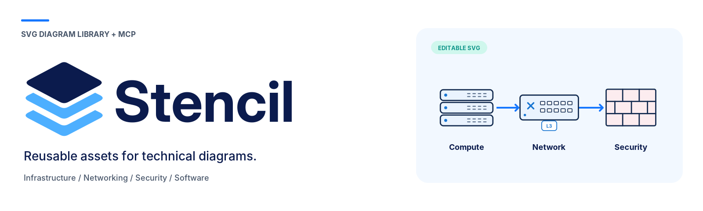
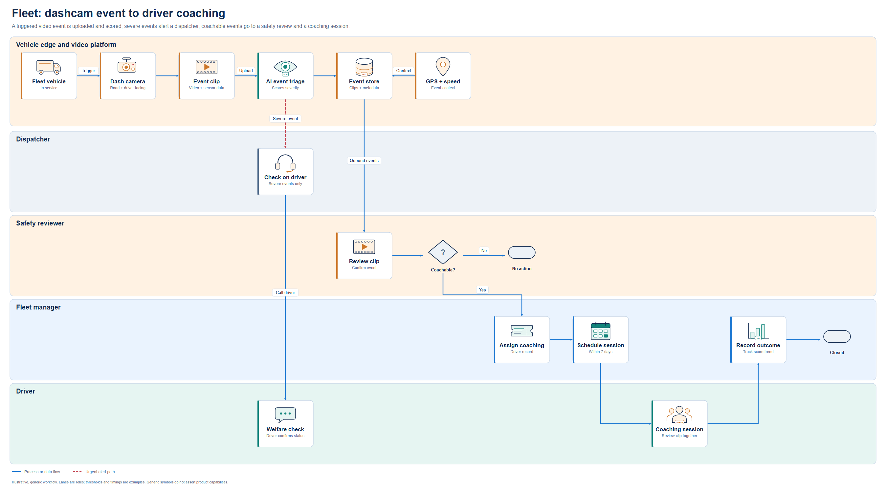
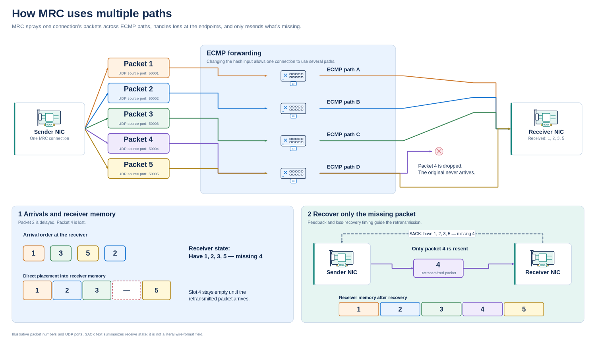
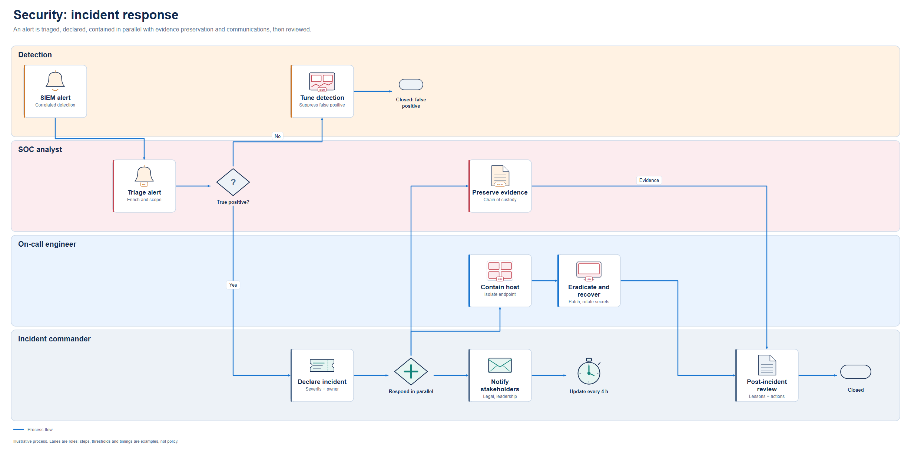
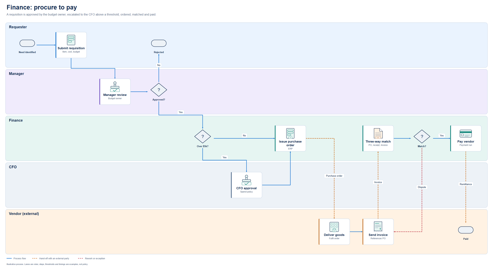

<div align="center">



# Stencil

<p align="center">
  <a href="LICENSE"></a>
  <a href="https://www.python.org/">= 3.10" /></a>
  
  
</p>

</div>

Stencil is a local MCP server and SVG symbol library for Claude Code, Codex and other MCP clients. The model searches a catalog of 324 generic symbols, writes a diagram as scene JSON, validates it, and renders a deterministic, editable SVG. The scene JSON is the source of truth: change the scene and render again rather than hand-editing the SVG.

It covers infrastructure, networking, security, Kubernetes, data, AI/agent systems and packet-level explanations, plus business-process swimlanes for engineering, security, IT, finance, HR, sales, fleet operations and support.

**324 SVG assets · 20 categories · 24 diagram templates · 12 MCP tools · Python standard library only**

<p align="center">
  
  
</p>

## Install

Python 3.10 or newer. Stencil has no runtime dependencies. Install the wheel from the [latest release](https://github.com/malindarathnayake/stencil-mcp/releases/latest) as a tool, so it gets its own environment and the `stencil-mcp` command lands on your PATH:

```bash
uv tool install https://github.com/malindarathnayake/stencil-mcp/releases/download/v0.2.0/stencil_mcp-0.2.0-py3-none-any.whl
# or: pipx install <same URL>
# or straight from the tag: pipx install git+https://github.com/malindarathnayake/stencil-mcp.git@v0.2.0
```

Register it with Claude Code, then confirm the host sees it:

```bash
claude mcp add --transport stdio --scope user stencil -- stencil-mcp
claude mcp get stencil
```

Then ask for a diagram:

```text
Use the stencil MCP. Start from the sec-incident-response template and adapt it
for a ransomware alert on a file server. Keep the lanes, validate, render, look
at the result, and export it as ransomware-ir.
```

The host starts `stencil-mcp` as a child process; there is no daemon to run. Upgrade by installing a newer wheel (`uv tool install --force <URL>`). Without installing anything, `uvx --from <wheel URL> stencil-mcp` also works as the server command.

<details>
<summary><b>Codex, Claude Desktop, Windows, and the export folder</b></summary>

Codex:

```bash
codex mcp add stencil -- stencil-mcp
```

or in `~/.codex/config.toml`:

```toml
[mcp_servers.stencil]
command = "stencil-mcp"

[mcp_servers.stencil.env]
INFRA_DIAGRAM_OUTPUT_DIR = "/ABSOLUTE/PATH/diagram-exports"
```

Claude Desktop does not search your shell PATH reliably; use the full path that `which stencil-mcp` (or `where stencil-mcp` on Windows) prints as the `command` in its `mcpServers` entry. The Desktop setup has not been live-tested.

`export_diagram` writes only into `INFRA_DIAGRAM_OUTPUT_DIR` (default `~/infra-diagram-exports`). Set it with `claude mcp add -e INFRA_DIAGRAM_OUTPUT_DIR=/path ...`. Point it at a local folder, not a synced or shared one, if your diagrams describe internal systems.

</details>

<details>
<summary><b>Run from a clone (contributors)</b></summary>

```bash
git clone https://github.com/malindarathnayake/stencil-mcp.git
cd stencil-mcp
python -m unittest discover -s tests      # one optional CairoSVG test skips
python scripts/client_config.py           # prints registration commands for this machine
```

`client_config.py` prints the `stencil-mcp` command when the package is installed, and otherwise this machine's interpreter plus the absolute path to `server.py`. It writes snippets under `config/` and never edits your client settings. `pip install -e .` gives you the `stencil-mcp` command pointing at the clone.

</details>

## How the model uses it

```text
library_info / get_guidelines   learn the categories, connector meanings and composition rules
search_assets                   find symbol ids by role ("firewall", "invoice", "dashcam"); metadata only
get_template / list_templates   start from one of the 24 editable scenes
layout_diagram                  first-pass positions for a small graph (DAG layering, grid fallback)
validate_diagram                schema, ids, bounds, overlaps, text fit, edges crossing nodes
render_diagram                  self-contained SVG text plus the validation report
preview_diagram                 PNG for visual review (needs optional CairoSVG)
export_diagram                  writes <name>.svg and <name>.scene.json to the export folder
```

Search returns compact metadata, so the model never loads all 324 SVG bodies; the renderer pulls in only the symbols a scene uses. Every tool is read-only except `export_diagram`.

<details>
<summary><b>A minimal scene</b></summary>

```json
{
  "version": "1.0",
  "title": "Application request path",
  "width": 1100,
  "height": 430,
  "nodes": [
    {"id": "client",  "kind": "component", "asset": "software/browser",    "x": 45,  "y": 180, "label": "Client"},
    {"id": "gateway", "kind": "component", "asset": "network/api-gateway", "x": 445, "y": 180, "label": "API gateway"},
    {"id": "api",     "kind": "component", "asset": "software/rest-api",   "x": 845, "y": 180, "label": "Application API"}
  ],
  "edges": [
    {"id": "request",  "source": "client",  "target": "gateway", "kind": "data", "label": "HTTPS"},
    {"id": "upstream", "source": "gateway", "target": "api",     "kind": "data", "label": "Forward"}
  ]
}
```

Node kinds: `component` (symbol in a labelled card), `symbol` (bare symbol, optional `caption`), `packet`, `memory`, `text`, `marker`. Edge kinds carry meaning: `data`, `control`, `physical`, `feedback`, `dependency`, `tunnel`, `replication`. Groups draw panels, trust boundaries and swimlanes. Full reference: [docs/SCENE_FORMAT.md](docs/SCENE_FORMAT.md).

</details>

<details>
<summary><b>More prompts</b></summary>

```text
Use the stencil MCP. Draw an Internet-facing app: WAF, API gateway, Kubernetes
services, a database and a separate logging path. Start from kubernetes-ingress,
keep physical links separate from request arrows, label the trust boundaries,
and split into panels rather than shrinking labels.
```

```text
Use the stencil MCP. Draw our purchase approval as swimlanes: Requester,
Manager, Finance, Vendor. Over $10k goes to the CFO. Copy the conventions in
fin-procurement-approval: questions on decisions, labelled Yes/No branches,
dashed orange for anything sent to the vendor.
```

```text
Use the MRC loss-recovery template. Keep packets 1-5: arrival order 1, 3, 5, 2;
packet 4 is lost; SACK says "Have 1, 2, 3, 5 - missing 4"; retransmit only 4.
Do not draw the dropped original reaching the receiver.
```

</details>

## Examples

Every template ships as scene JSON in [`diagramkit/library/templates/`](diagramkit/library/templates/) and as SVG + PNG in [`examples/`](examples/). Open [`gallery.html`](gallery.html) for an offline, searchable view of every symbol and template.

**Department processes** (swimlanes; lanes are roles, time runs left to right)

| Department | Template | Shows |
| --- | --- | --- |
| Engineering | [`eng-platform-delivery`](examples/eng-platform-delivery.png) | Pull request → review loop → CI → release gate → deploy, with rollback |
| Security | [`sec-incident-response`](examples/sec-incident-response.png) | Triage, declare, then contain, preserve evidence and notify in parallel |
| IT | [`it-onboarding-access`](examples/it-onboarding-access.png) | New-hire ticket → account → laptop → privileged approval → MFA |
| Finance | [`fin-procurement-approval`](examples/fin-procurement-approval.png) | Spend threshold, purchase order, three-way match, dispute, payment |
| HR | [`hr-employee-onboarding`](examples/hr-employee-onboarding.png) | Contract, parallel preparation by HR, manager and IT, 30-day check-in |
| Sales | [`sales-lead-to-cash`](examples/sales-lead-to-cash.png) | Qualify, quote, negotiate, order, invoice, revenue |
| Fleet operations | [`fleet-video-event-coaching`](examples/fleet-video-event-coaching.png) | Dashcam event → AI triage → dispatcher alert or safety review → coaching |
| Customer support | [`support-escalation`](examples/support-escalation.png) | L1 → L2 under an 8-hour SLA → engineering fix → customer confirmation |

**Architecture and protocols**

| Template | Shows |
| --- | --- |
| [`mrc-loss-recovery`](examples/mrc-loss-recovery.png) | Packet spraying across ECMP paths, one loss, SACK, retransmit only the missing packet |
| [`ecmp-flow-hashing`](examples/ecmp-flow-hashing.png) | Two flows hashing onto the same equal-cost path |
| [`leaf-spine`](examples/leaf-spine.png), [`segmented-network`](examples/segmented-network.png), [`hybrid-cloud`](examples/hybrid-cloud.png) | Network topology and placement |
| [`zero-trust-access`](examples/zero-trust-access.png), [`threat-model-dfd`](examples/threat-model-dfd.png), [`secure-ci-cd`](examples/secure-ci-cd.png) | Security controls and trust boundaries |
| [`kubernetes-ingress`](examples/kubernetes-ingress.png), [`event-driven`](examples/event-driven.png), [`software-overview`](examples/software-overview.png), [`sequence-request`](examples/sequence-request.png) | Application architecture |
| [`agent-mcp-tools`](examples/agent-mcp-tools.png), [`disaggregated-inference`](examples/disaggregated-inference.png) | AI agents and inference |
| [`observability-pipeline`](examples/observability-pipeline.png), [`backup-dr`](examples/backup-dr.png) | Operations |

<p align="center">
  
  
</p>

<details>
<summary><b>What is in the library</b></summary>

| Collection | Assets | | Collection | Assets |
| --- | ---: | --- | --- | ---: |
| Compute & virtualization | 15 | | Development & delivery | 20 |
| Hardware & accelerators | 14 | | Observability & operations | 12 |
| Network devices | 20 | | AI & agent systems | 20 |
| Routing & overlays | 19 | | Resilience & traffic policy | 10 |
| Security controls | 24 | | Packets & transport | 21 |
| Identity & cryptography | 14 | | Diagram notation | 20 |
| Storage & continuity | 13 | | State markers | 10 |
| Cloud & locations | 14 | | Business process | 15 |
| Kubernetes & containers | 21 | | Fleet telematics | 9 |
| Software & integration | 19 | | Data systems | 14 |

Many entries are role variants of a shared glyph with a badge (128 base shapes). All symbols are original generic drawings: no vendor logos, fonts or raster images. Search aliases such as Proxmox, Rancher or NVIDIA find the matching generic symbol; they are not compatibility claims. Contact sheets for each collection are in [`previews/`](previews/).

</details>

<details>
<summary><b>Render without MCP</b></summary>

```bash
python -m diagramkit.cli search invoice
python -m diagramkit.cli templates
python -m diagramkit.cli validate diagramkit/library/templates/support-escalation.json
python -m diagramkit.cli render diagramkit/library/templates/support-escalation.json --output out/support.svg
```

`render` refuses to overwrite an existing file unless you pass `--overwrite`.

</details>

<details>
<summary><b>Security model and limits</b></summary>

- **Local and single-user.** stdio only, no network listener, no outbound requests, no shell, no telemetry.
- **No caller-supplied markup.** Scenes cannot carry SVG, HTML, CSS, scripts or image URLs. All text is XML-escaped; control, invisible, bidirectional-override and non-XML characters are rejected.
- **Bounded input.** 1 MiB per message, at most 200 nodes and 400 edges per scene, 200 validation issues per report.
- **Confined writes.** `export_diagram` accepts a filename stem only, writes only into the export folder, refuses symlinks and Windows device names, never overwrites unless asked, and stages both files before publishing them.
- **Checked assets.** The renderer verifies each symbol's SHA-256 against the catalog and rejects active SVG content.

Validation checks structure and layout: ids, bounds, overlaps, text fit, edges crossing nodes. It cannot tell you that an architecture is secure, a protocol is drawn correctly, or a product supports a feature. Look at the rendered output. The layout helper is a first pass, not an obstacle-avoiding router; set ports and waypoints for clean edges. A shared HTTP deployment needs the official MCP SDK plus authentication and isolated storage; see [docs/MCP.md](docs/MCP.md).

</details>

<details>
<summary><b>Rebuilding and extending</b></summary>

```bash
python scripts/build_library.py     # symbol geometry and catalog.json
python scripts/build_schema.py      # scene.schema.json
python scripts/build_templates.py   # 24 templates and example SVGs
python scripts/build_gallery.py     # previews/ and gallery.html (PNGs need CairoSVG)
python scripts/build_release.py     # asset-packs.json, VALIDATION_REPORT.json, MANIFEST.sha256
python -m pip wheel . --no-deps -w dist   # the release wheel
```

CI (`.github/workflows/ci.yml`) runs the tests on Linux, Windows and macOS, fails if a rebuild changes any committed generated file, and builds and smoke-tests the wheel. Pushing a `v*` tag publishes the wheel to a GitHub Release.

Builds are deterministic and write LF line endings on every OS, so a rebuild without source changes is byte-identical. Asset ids are public API: the original 300 symbols are pinned byte-for-byte by `tests/fixtures/legacy_sha256.json`, and new symbols are additive. Adding roles, shapes or a separately licensed vendor pack: [docs/EXTENDING.md](docs/EXTENDING.md).

</details>

## Documentation

| Document | Covers |
| --- | --- |
| [docs/DESIGN_SYSTEM.md](docs/DESIGN_SYSTEM.md) | Composition rules, connector meanings, process-diagram notation |
| [docs/SCENE_FORMAT.md](docs/SCENE_FORMAT.md) | Scene JSON reference |
| [docs/MCP.md](docs/MCP.md) | Tools, resources, transport and export policy |
| [docs/EXTENDING.md](docs/EXTENDING.md) | Adding symbols, templates and packs |
| [docs/PACK_COVERAGE.md](docs/PACK_COVERAGE.md) | What each pack covers and what is not implemented |
| [CHANGELOG.md](CHANGELOG.md) | Release notes |
| [branding/BRAND_GUIDE.md](branding/BRAND_GUIDE.md) | Logo and repository graphics |
| [AGENTS.md](AGENTS.md) | Rules for coding agents working in this repo |

## License

Apache License 2.0. See [LICENSE](LICENSE).
