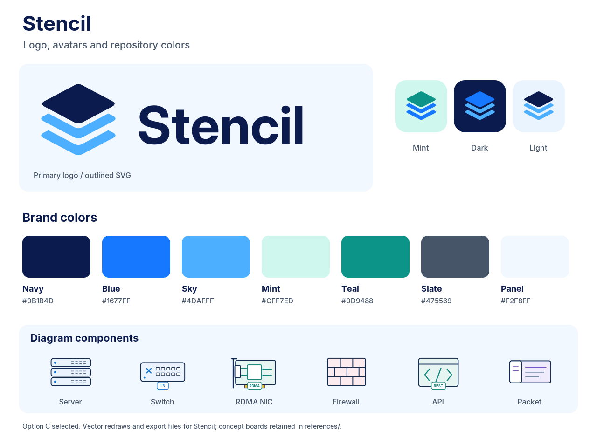

# Stencil — brand guide

**Name:** Stencil  
**Repository slug used in this bundle:** `stencil-mcp`  
**MCP registration name:** `stencil`  
**Selected identity:** option C, the three stacked layers.

## Use these files

| Use | File |
| --- | --- |
| Primary GitHub/avatar icon | `avatars/stencil-avatar-mint-512.png` |
| Dark avatar | `avatars/stencil-avatar-dark-512.png` |
| Light avatar | `avatars/stencil-avatar-light-512.png` |
| Horizontal logo on a light background | `logos/stencil-lockup-light.svg` |
| Horizontal logo on a dark background | `logos/stencil-lockup-dark.svg` |
| Mark without the name | `logos/stencil-mark-primary.svg` |
| Single-color applications | `logos/stencil-mark-navy.svg` or `logos/stencil-mark-white.svg` |
| README header | `banners/stencil-readme-banner.png` |
| Repository social artwork | `banners/stencil-social-preview.png` |
| Small website icon | `avatars/stencil-favicon.svg` |

SVG originals and PNG exports are included. Avatar exports cover 1024, 512, 128, 64 and 32 pixels. The unsuffixed avatar PNG is the 1024-pixel export.

## Colors

| Role | Hex |
| --- | --- |
| Primary navy | `#0B1B4D` |
| Primary blue | `#1677FF` |
| Layer sky blue | `#4DAFFF` |
| Avatar mint | `#CFF7ED` |
| Avatar teal | `#0D9488` |
| Pale blue | `#EAF4FF` |
| Panel | `#F2F8FF` |
| Supporting text | `#475569` |
| White | `#FFFFFF` |

Semantic colors available for diagrams: success `#16A34A`, warning `#F97316`, error `#DC2626`, purple `#8B5CF6`, and yellow `#EAB308`. A diagram legend determines packet/path colors; a green packet is not automatically a success indicator.

The primary logo has a navy top layer and sky-blue lower layers. The mint avatar has a teal top layer and blue lower layers. The dark avatar has a blue top layer and sky-blue lower layers. Keep these as separate named variants.

## Typography and spacing

The production wordmark uses an outlined Inter Display Bold treatment. Use the outlined files for a consistent appearance without a font installation. `stencil-lockup-editable-text.svg` is also supplied for text editing; its appearance depends on the local font. No font files are included.

For documentation and UI, use `Inter, Arial, Helvetica, sans-serif`. Use a monospace stack for asset IDs, ports and protocol fields. Keep the symbol upright and preserve its aspect ratio. Leave clear space of at least one eighth of the symbol width. Use the symbol alone below approximately 120 pixels of horizontal space. Do not add circuitry, clouds, shields, AI sparkles or category badges to the logo.

## Brand versus diagram colors

`tokens.json` and `tokens.css` govern the repository branding. The existing renderer's palette is in `../diagramkit/library/palettes.json`. The 300 original icon files and their hashes are unchanged in this packaging release; they have not been silently recolored to the newer brand hex values.

Preserve a packet or VLAN's color throughout a diagram. Pair color with labels or explicit markers. Keep sender/receiver positions consistent across panels. Retain the MRC design's light background and readable spacing; split crowded explanations into additional panels.

## Source and status

The user approved **Stencil and option C's design direction**. These production SVGs are redraws of that raster concept, not vector files recovered from the image. Exact mint/sky values, export sizes and the outlined type treatment were chosen while preparing this bundle. The original approved board is retained in `../references/branding/`.

The repository slug is a working name, not a claim of GitHub, package-registry, domain or trademark availability. The software is licensed under Apache-2.0. The bundle does not grant rights to third-party marks that may appear in historical concept images.

## Rebuild

Run `python3 scripts/build_brand.py` from the repository root. SVG generation uses the saved outline geometry and standard library. PNG export uses optional CairoSVG. The script does not regenerate the core diagram library.
